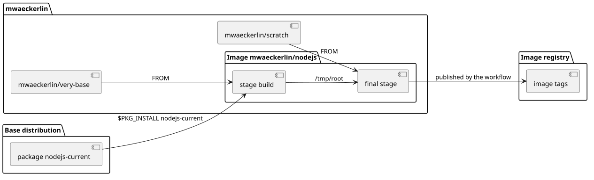
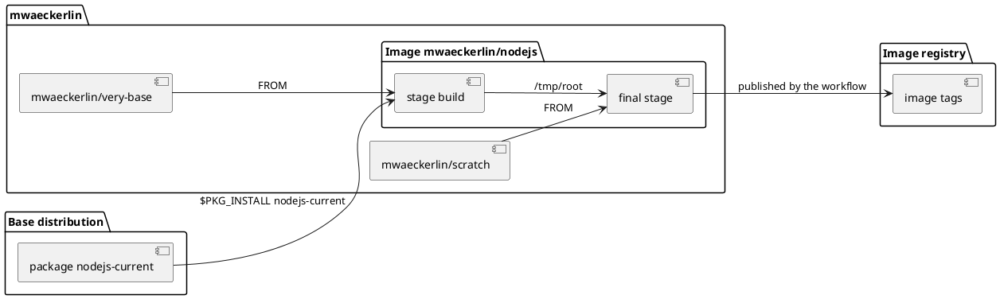
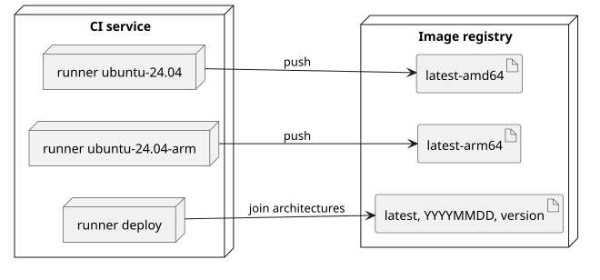
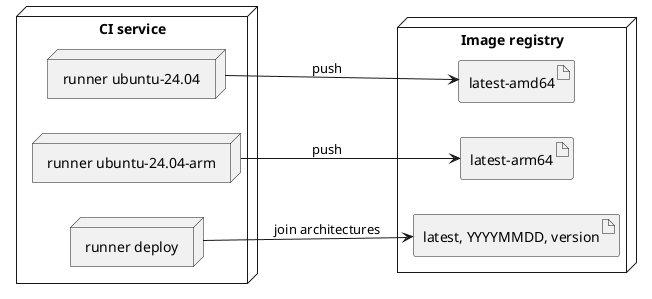

# Architecture of mwaeckerlin/nodejs

- **Reader:** maintainers of this repository and authors of Node.js service images built on it
- **Content:** the headless Node.js runtime base, as built

## 1. Introduction and Goals

### 1.1 Requirements Overview

The author of a Node.js service builds his application in `mwaeckerlin/nodejs-build`, then starts the final stage with `FROM mwaeckerlin/nodejs` and copies `dist` and `node_modules` to `/app`. The container runs `node /app/dist/src/main` as the unprivileged user `somebody` with `NODE_ENV=production`; another entry point is a `CMD` with the script only, because `node` is the entrypoint. The image contains no shell, no package manager and no npm, and is published for amd64 and arm64 on the [image registry](#image-registry). The features are listed in [FEATURES.md](FEATURES.md).

### 1.2 Quality Goals

1. **Headless:** nothing in the image runs but `node`.
2. **Small:** `node`, its shared libraries and the ICU data, nothing else.
3. **Unprivileged:** the application runs as `somebody` in `/app`.

### 1.3 Stakeholders

- **Image author:** writes the final stage of his service on this image.
- **Operator:** runs the service and cannot open a shell in it.

## 2. Architecture Constraints

### 2.1 Technical Constraints

- The build stage is `mwaeckerlin/very-base`, the final stage `mwaeckerlin/scratch`; `node` comes as a package of the [base distribution](#base-distribution).
- `PATH` is empty: the image holds no command to look up.
- No version is written into the Dockerfile; the package manager installs the current `nodejs-current`, which carries the active LTS on Alpine 3.24, while the package `nodejs` carries the previous one.

### 2.2 Organisational Constraints

- The image is built and published by the reusable workflow of `mwaeckerlin/scratch` on the [CI service](#ci-service).

## 3. Context and Scope

### 3.1 Business Context

Service images name this image in their final `FROM`; the image knows nothing of them.

### 3.2 Technical Context

The build reads the package archive of the [base distribution](#base-distribution) through `mwaeckerlin/very-base` and the image `mwaeckerlin/scratch`.

## 4. Solution Strategy

The build stage installs `nodejs-current`, then copies `/usr/bin/node`, `/usr/share/icu` and every library `ldd /usr/bin/node` names into `/tmp/root`, with their directories. The final stage copies `/tmp/root` onto `mwaeckerlin/scratch`, which brings the users and switches to `somebody`.

## 5. Building Block View

### 5.1 Whitebox Overall System

PlantUML source

### 5.2 Content of the Final Stage

| Path | Content |
| --- | --- |
| `/usr/bin/node` | the interpreter, entrypoint of the image |
| `/usr/share/icu` | the ICU data the package installs, English only (`icu-data-en`) |
| the libraries `ldd` names | the shared libraries of `node`, below `/lib` and `/usr/lib` |
| `/etc/passwd`, `/etc/group`, `/home/somebody`, `/home/coder` | the users of `mwaeckerlin/scratch` |

| Setting | Value |
| --- | --- |
| `ENTRYPOINT` | `["/usr/bin/node"]` |
| `CMD` | `["/app/dist/src/main"]` |
| `NODE_ENV` | `production` |
| `PATH` | empty |
| `USER`, `WORKDIR` | `somebody`, `/app` |

## 6. Runtime View

### 6.1 Start of a Service Container

1. Docker starts `/usr/bin/node` with the `CMD` of the derived image, by default `/app/dist/src/main`.
2. `node` resolves `node_modules` from `/app` and runs as `somebody` with `NODE_ENV=production`.

## 7. Deployment View

### 7.1 Publishing Infrastructure

PlantUML source

Each runner builds the image natively, runs `npm test` and pushes its architecture tag; the deploy job joins both under every tag once both are green.

## 8. Cross-cutting Concepts

### 8.1 Headless Final Stage

The final stage receives files only through `COPY --from=build`; no `RUN` executes in it, because it has nothing to run a command with.

## 9. Architecture Decisions

### 9.1 Library List from ldd

The libraries are read from `ldd /usr/bin/node` at build time, so a new dependency of `node` reaches the image without a change to the Dockerfile.

## 10. Quality Requirements

### 10.1 Quality Scenarios

| Scenario | Measure |
| --- | --- |
| An attacker reaches code execution | `tests/image-contract.sh`: no `sh`, `bash`, `busybox`, `perl` |
| A service starts without `CMD` | `tests/config-contract.sh`: `/app/dist/src/main.js` runs as `somebody` in `/app` with `NODE_ENV=production` |
| A service names another entry point | `tests/config-contract.sh`: `CMD ["/app/dist/main"]` runs |
| `Intl` formats a number | `tests/config-contract.sh`: `en-US` formats `1,234.5` |

## 11. Risks and Technical Debt

### 11.1 English ICU Data

The package installs only the English ICU data, so `Intl` formats every locale, `de-CH` among them, like English; the complete data cost about 30MB. Whether the image carries them is open.

## 12. Glossary

### 12.1 Terms

| Term | Definition |
| --- | --- |
| Headless | an image without shell, package manager or scripting language besides the service's own interpreter |
| ICU data | the locale tables `Intl` uses to format numbers, dates and text |

### 12.2 External Functions

| Logical designation | Description | Company in the UK | Company in Switzerland |
| --- | --- | --- | --- |
| Base distribution | Linux distribution on musl whose package `nodejs-current` the image carries, Alpine Linux | Alpine Linux project (community) | Alpine Linux project (community) |
| Image registry | stores and serves the published images, Docker Hub | Docker, Inc. (USA) | Docker, Inc. (USA) |
| CI service | runs the workflow on native amd64 and arm64 runners, GitHub Actions | GitHub, Inc. (USA) | GitHub, Inc. (USA) |
